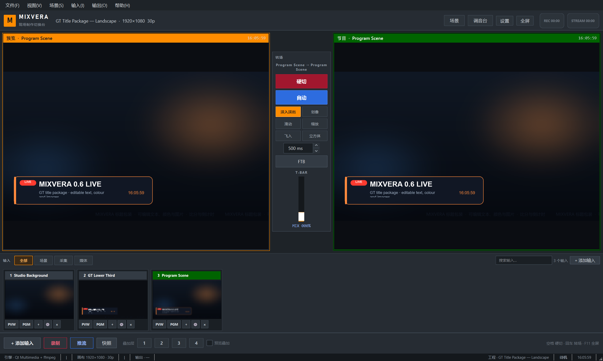
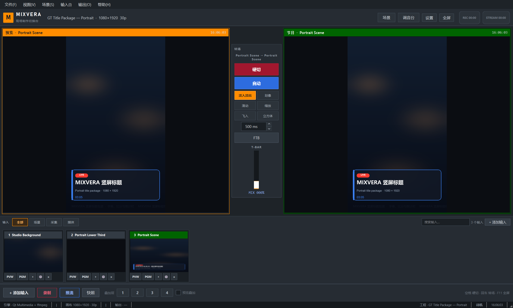
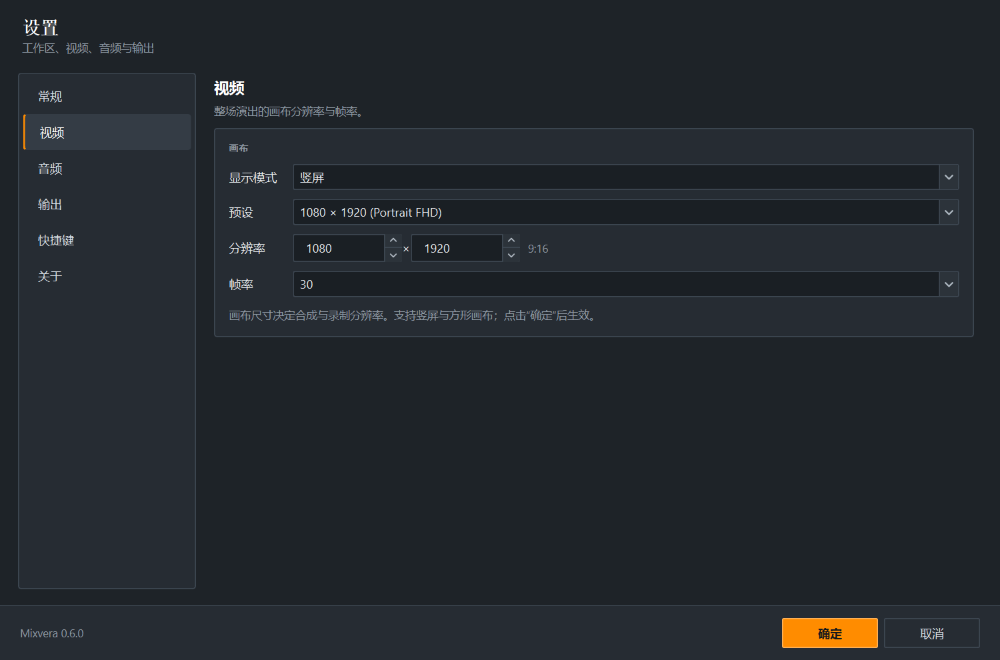
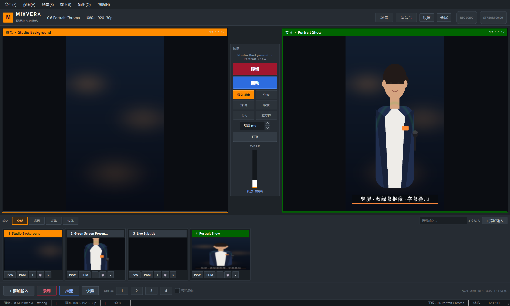
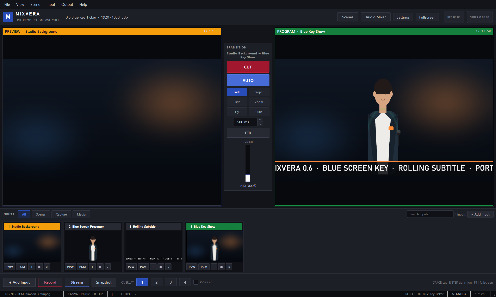
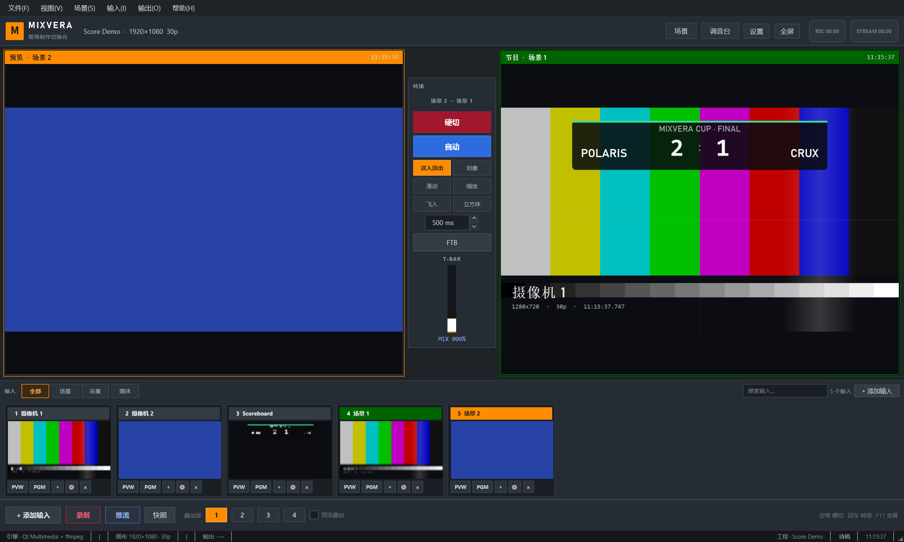
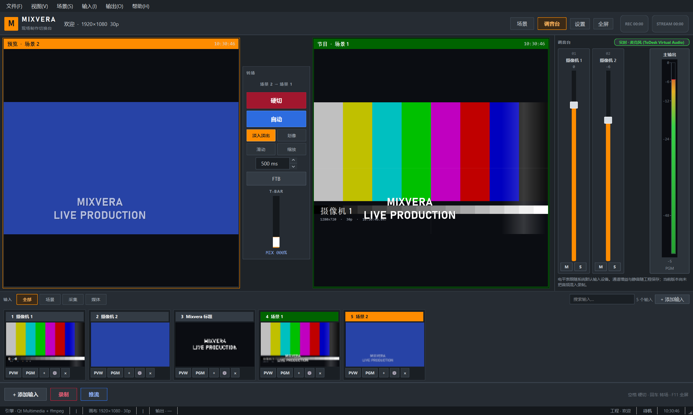
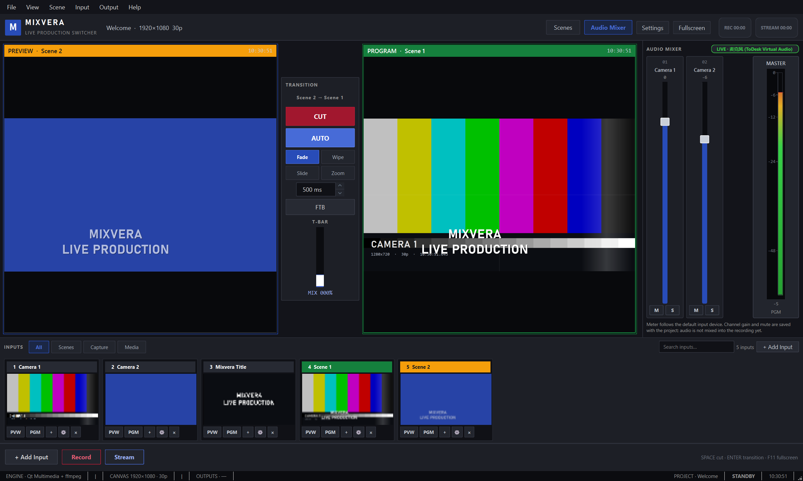

# Mixvera

Mixvera 是一个面向现场导播场景的开源切换台。`0.6.0` 在 0.5 的叠加层、转场与标题之上，加入芯象（SinSam）风格的**竖屏 / 方形画布、横竖屏显示模式、蓝绿幕抠像与字幕叠加**，并移植 vMix GT / 芯象（SinSam）的**标题包装**：直接打开 `.gtzip`，渲染元素、渐变、图片、滚动字幕、二维码与时钟，支持命名预置与数据变更动画。







芯象竖屏、抠像与字幕：





0.5 的四路叠加层、Fly / Cube 转场、标题预置与快照沿用不变：




0.4 的三套主题、OBS 式调音台与设置界面沿用不变：





## 0.6 新增（芯象竖屏 / 显示模式 / 抠像 / 字幕 / GT 标题包装）

证据来源：对 `sinsam_setup.26.7.10.3.exe` 的只读逆向（未运行安装包），以及本机 vMix 28 安装目录 `titles/` 下 **743 个 `.gtzip` 与 87 个 `.xaml`** 的只读解析。芯象证据与取舍见 [docs/RE-SINSAM.md](docs/RE-SINSAM.md)，界面映射见 [docs/UI-SPEC.md](docs/UI-SPEC.md)。包装文件只作为输入读取，仓库不分发任何 vMix / SinSam 模板。

### 标题包装

添加输入 → 标题的第七种样式。选择 `.gtzip`、未压缩的包装目录或散装 `.xaml` / `.sinsamtitle` 后，Mixvera 用自写渲染器按 GT 文档逐帧绘制，并把包装缩放到当前画布：

| 类别 | 支持 |
| --- | --- |
| 容器与形状 | `Composition`、`Layer`、`Rectangle`（圆角 / 描边）、`Ellipse`、`Triangle`、`RightTriangle` |
| 文本与媒体 | `TextBlock`（字体、字号、粗体、对齐、换行）、`Image`（铺满 / 等比）、`Ticker` |
| 画笔 | `Solid`、`LinearGradient`、`RadialGradient`、`Transparent`、`Bitmap` |
| 动画 | Fade / Fly / Reveal / Expand / ZoomFade / Zoom / Bounce / Rotate；入口、`TransitionOut`、`DataChangeIn/Out` |
| 动态内容 | `{0:...}` 时钟 / 倒计时、`QRCode`（真实二维码编码） |

- **几何与旋转**：`Location` / `Dimensions` 以设计画布为单位；`Transform Rotate` 取 z 轴弧度。GT Vertical 的 3412×1920 艺术板按高度缩放并居中，裁切后仍对准中心 1080×1920 区域
- **滚动字幕**：自动取 Ticker 模板里最宽的文本块；Direction 为 top / bottom / up / down / vertical 时整条旋转 −90° 竖向滚动，其余水平滚动
- **时钟**：`{0:HH:mm:ss}`、`{0:hh:mm tt}`、`{0:4:00PM|mm:ss}` 等 .NET 自定义格式；倒计时使用 `|` 后的格式段，暂停时数字冻结
- **二维码**：ISO/IEC 18004 字节模式、纠错等级 M、版本 1–10、自动掩码选择；内容超过 213 字节时显示红色占位
- **元素编辑**：「Elements…」列出可编辑的文本 / 图片 / 颜色元素；覆盖随工程保存，不改动原始包装文件
- **命名预置**：每个包装 10 组命名快照，输入条右键保存 / 上一个 / 下一个 / 删除；切换预置播放包装自己的 `DataChangeIn` 动画，且不打断入场动画与滚动字幕

### 显示模式

- 设置 → 视频的第一项就是「显示模式」：横屏 / 竖屏。切换时保留长短边并交换宽高；方形画布会展开为 16:9，避免出现没有方向的「竖屏 1080×1080」
- 预设、宽高输入与像素比标签联动：选 `1080 × 1920 (Portrait FHD)` 会自动切到竖屏，改宽高也会同步模式
- 「视图 → 横屏模式 / 竖屏模式」可在演出中一键切换；`--mode landscape|portrait` 可在启动时指定
- 显示模式只决定画布方向；工作区仍是横向双监视器

### 竖屏与方形画布

- 设置 → 视频新增 `1080 × 1920`（Portrait FHD）、`720 × 1280`（Portrait HD）、`1080 × 1080`（Square）预设
- 「视图 → 横屏模式 / 竖屏模式」一键切换：保留当前长短边，交换宽高；与设置里的显示模式同步（见上）
- 启动参数 `--canvas 1080x1920` 可直接指定画布，适合竖屏直播与手机端录制
- 画布尺寸同时驱动合成、录制、推流与快照；标题会按画布宽度重新排版，竖屏下字幕贴底而不是被裁掉

### 蓝 / 绿幕抠像

- 任意采集、图片或视频输入可开启色度键控；绿幕 / 蓝幕一键预设，也可选任意自定义色
- 三个参数：**相似度**（键色容差）、**平滑度**（边缘羽化）、**溢色抑制**（压掉头发与肩部的绿/蓝边）
- 添加输入对话框有独立的「CHROMA KEY」面板；输入条右键「抠像」可以随时切换关 / 绿幕 / 蓝幕
- 抠像发生在采集之后、场景合成之前，叠加层、转场、录制、推流与快照得到的都是抠像后的画面
- 参数随工程保存；调整参数时采集源不会重建，摄像头画面不闪断

### 字幕叠加

标题样式由四种扩展为七种：

| 样式 | 内容 |
| --- | --- |
| 全屏标题 | 多行文本样式 |
| 下三分之一字幕 | 主标题 + 副标题、左侧强调色条 |
| 倒计时 | 居中 `MM:SS`、进度条、真实时钟 |
| 比分牌 | 赛事名 + 主客队比分 |
| **字幕条** | 底部安全区半透明底板、居中自动换行、强调色下划线 |
| **滚动字幕** | 底部滚动条，从右向左无缝循环，速度 20–800 px/s |
| **标题包装** | 读取 GT `.gtzip` / `.xaml`，保留模板布局、动画与时钟 |

- 字幕 / 滚动字幕输入可预置多行文案，右键「设置字幕文字…」或「下一句 / 上一句 / 清除字幕」实时切换
- 字幕与下三分之一不同：字幕条始终贴底、按画布宽度自适应，适合访谈、带货与竖屏短视频

## 0.5 新增（SinSam 移植）

证据来源：对 `sinsam_setup.26.7.10.3.exe` 的只读逆向（未运行安装包），功能地图、证据 id 与取舍见 [docs/RE-SINSAM.md](docs/RE-SINSAM.md)。

### 四路下游叠加层

- 页脚 `OVERLAY 1–4`：点击开关该层；层未分配输入时点击弹出选择菜单；右键随时更换输入
- 一个输入同一时间只能在一个层上，分配到新层会自动从旧层移除
- 叠加层位于**转场之后、FTB 之前**（与 vMix / SinSam 总线一致），录制与推流收到的是叠加后的画面
- 场景作为叠加输入时以透明背景渲染，字幕、角标等元素保留透明度
- `PVW OVL` 复选框让预览监视器也显示叠加结果
- 输入条右键「叠加层」子菜单可直接把输入分配到 1–4 层或移除；删除输入时自动清出所有层
- 叠加层随工程 JSON 保存与恢复

### Fly / Cube 转场

- 转场栏由 2×2 扩展为 2×3：淡入淡出 / 划像 / 滑动 / 缩放 / **飞入** / **立方体**
- 飞入：出画卡片缩小上飞、入画卡片从右下旋入
- 立方体：水平立方旋转，面压缩到边缘再展开，带明暗渐变模拟立方体侧光

### 标题预置与实时控制

「添加输入 → 标题」新增样式选择：

| 样式 | 内容 |
| --- | --- |
| 全屏标题 | 原有多行文本样式 |
| 下三分之一字幕 | 主标题 + 副标题、左侧强调色条、自适应宽度 |
| 倒计时 | 居中大号 `MM:SS`、进度条、归零变红；支持开始 / 暂停 / 重置，走真实时钟 |
| 比分牌 | 赛事名 + 主客队名与比分、居中对撞布局 |

- 输入条右键「标题控制」：开始 / 暂停 / 重置倒计时，主客队得分 ±1，全部实时生效
- 倒计时剩余时间与比分随工程保存，重启不丢
- 0.5 的标题使用内置预置；0.6 起新增「标题包装」样式，可直接打开 vMix / SinSam 的 `.gtzip` / `.xaml`（见上）

### 快照

- 页脚「快照」按钮或 `Ctrl+Shift+P`，把当前节目输出（含叠加与 FTB）保存为时间戳命名的 PNG 到录制目录
- 也可从「输出」菜单触发；状态栏显示保存路径

## 0.4 主题 / 调音台 / 设置

### 三套主题

- **Charcoal**（默认）：vMix 式炭灰表面 + 橙色控制强调，预览橙 / 节目绿保持信号色
- **Yami**：取自 OBS `Yami.obt` 的蓝灰三级表面（`#13141A` / `#1D1F26` / `#272A33`）与蓝色强调 `#284CB8`
- **Daylight**：浅色高对比界面，适合明亮导播间；监视器仍为近黑底，画面不受主题影响
- 47 个颜色/图标 token 驱动一份 QSS 模板与全部自绘控件，界面里没有散落的颜色字面量
- 设置里选中主题**即时预览**，取消会恢复原主题；`--theme charcoal|yami|daylight` 或 `MIXVERA_THEME` 可指定

### 调音台

- OBS 式通道条：编号、名称、增益 dB、竖向推子（-60…+12 dB）、`M` / `S`
- 双电平平段的主输出表（绿/黄/红）带刻度、峰值保持与 dB 读数
- 推子双击复位 0 dB；静音与增益随工程保存，独奏为监听状态
- 电平由系统默认录音设备真实驱动；没有设备时显示 `NO AUDIO INPUT`

### 设置界面

- 左侧分类导航 + 右侧分页：常规、视频、音频、输出、快捷键、关于
- 主题卡片带实时缩略图；「跟随系统语言」与「启动时恢复上次会话」是真实生效的设置
- 视频页设置画布预设/分辨率/帧率，输出页管理录制目录、ffmpeg 与 RTMP
- 统一样式的主/次按钮、下拉与微调箭头图标，三套主题下都清晰

设置界面截图：[常规（中文）](docs/demo/mixvera-0.4-settings-general-zh.png)、[音频（英文）](docs/demo/mixvera-0.4-settings-audio-en.png)、[视频（中文）](docs/demo/mixvera-0.4-settings-video-zh.png)。

## 0.3 新增

### 简体中文

- 全部界面文案（213 条）已翻译为简体中文，启动时自动按系统语言选择；中文系统直接显示中文
- `设置 → 界面语言` 可在「简体中文 / English」之间切换，下次启动生效
- 也可用命令行 `--lang zh_CN`、环境变量 `MIXVERA_LANG=zh_CN` 强制指定
- 翻译以 Qt `tr()` + `.ts` / `.qm` 管理，`.qm` 通过 Qt 资源内嵌进 exe，分发时无需额外语言文件

英文界面截图见 [docs/demo/mixvera-0.3-en.png](docs/demo/mixvera-0.3-en.png)。

术语优先采用 OBS 中文语言包的专业说法（Cut → 硬切、Fade → 淡入淡出、Wipe → 划像、Stream → 推流），没有沿用 vMix 机器翻译里的「切 / 褪色 / 擦拭 / 流」。

### vMix 式工作区

- 预览在左（橙色标题条）、节目在右（绿色标题条），中央是竖向转场区：`硬切` / `自动` / 淡入淡出 / 划像 / 滑动 / 缩放 / FTB / T-BAR
- 底部横向输入条：缩略图、编号、名称、PGM/PVW 状态与快捷操作；分类筛选与搜索
- 底部功能栏：`+ 添加输入`、`录制`、`推流`；顶栏可显示/隐藏场景与调音台
- 配色直接取自 vMix 主窗口：背景 `#1E2328`、转场面板 `#404B56`、预览橙 `#FF8C00`、节目绿 `#006400`

## 这一版能做什么

### 真实输入

| 输入 | 说明 |
| --- | --- |
| 屏幕采集 | 按显示器序号抓取整个桌面 |
| 窗口采集 | 枚举可见顶层窗口，优先抓窗口本体，失败回退到屏幕区域 |
| 摄像头 | 通过 Qt Multimedia 采集，系统里没有摄像头时列表为空 |
| 图片 / 视频文件 | 图片直接显示；视频循环播放，画面进入合成；可开启抠像 |
| 标题 | 七种样式（全屏 / 下三分之一 / 倒计时 / 比分牌 / 字幕条 / 滚动字幕 / **标题包装**），倒计时、比分与字幕文字可实时控制；标题包装读取 GT `.gtzip` / `.xaml` |
| 纯色 / 测试图案 | 用于垫场与信号检查，测试图案带活动扫描光带和时码 |

采集类输入（屏幕 / 窗口 / 摄像头 / 图片 / 视频）都可以开启蓝绿幕抠像；标题、纯色与场景不做抠像。

### 场景与图层

- OBS 式「场景 / 源」两栏：场景列表、当前场景的图层列表
- 图层支持显隐开关、上移 / 下移、从场景移除
- 场景可新增、复制、重命名、删除
- 工程以 JSON 保存，退出自动保存、启动自动恢复（`%APPDATA%/Mixvera/project.json`）

### 导播与转场

- PVW / PGM 双监视器左右并排，画面来自同一条渲染时间线
- `硬切`、`自动`、`T-BAR` 手动推子（过半完成、不过半回退）
- 六种转场：淡入淡出 / 划像 / 滑动 / 缩放 / 飞入 / 立方体
- `FTB` 淡出到黑
- 转场时长 100–5000 ms 可调

### vMix 式输入条

- 横向滚动的输入条：实时缩略图、输入编号、名称与类型
- 每块输入带 `PVW` / `PGM` / 加入场景 / 属性 / 移除快捷按钮
- `PGM` 绿色、`PVW` 橙色标题条；双击打开属性；右键菜单提供同样的操作
- 按「全部 / 场景 / 采集 / 媒体」筛选，可搜索输入名称
- 「添加输入」对话框按类型给出对应参数（显示器、窗口、摄像头、文件、标题文本、颜色）

### 音频

- 右侧可收起的调音台：每个带音频的输入一条通道，推子（-60…+12 dB）、静音、独奏
- 增益与静音随工程保存；独奏只影响监听状态
- 主输出电平表由系统默认录音设备实时驱动（不是动画），带刻度与峰值保持
- 没有输入设备时明确显示「无音频输入」

### 输出

- `RECORD`：把合成后的 PGM 画面通过 ffmpeg 管道编码为 H.264 MP4
- `STREAM`：同一路画面推 RTMP（URL 与串流密钥在设置里配置）
- 顶栏 `REC` / `STREAM` 胶囊显示计时，状态栏显示 ON AIR / STANDBY
- 输出目录默认 `%USERPROFILE%/Videos/Mixvera`，可在设置里改成绝对路径

## 快捷键

| 按键 | 动作 |
| --- | --- |
| `Space` | 硬切 |
| `Enter` | 自动转场 |
| `F11` | 全屏 / 退出全屏 |
| `Esc` | 退出全屏 |
| `Ctrl+R` | 开始 / 停止录制 |
| `Ctrl+Shift+P` | 保存节目快照 |
| `Ctrl+I` | 添加输入 |
| `Ctrl+S` / `Ctrl+O` | 保存 / 打开工程 |

## 界面来源

界面不是凭印象画的，颜色、控件命名与信息组织取自 OBS Studio 33.0.3 安装包（本机安装为 32.1.2）、vMix 28 的可读产物与 SinSam 26.7.10.3 安装包的只读逆向。0.4 的 Yami 主题、调音台通道条与设置分类直接对应前两份证据；0.5 的叠加层、Fly / Cube 转场与标题预置，以及 0.6 的竖屏、显示模式、抠像、字幕与 GT 标题包装对应第三份与 vMix 本机模板库：

- **vMix 主窗口**：官方帮助页的主界面截图（`build/analysis/vmix/NewItem446.png`，本机分析目录，未入库）用于确定预览左 / 节目右的布局、中央竖向转场列、底部横向输入条与功能栏；从截图采样得到背景 `#1E2328`、转场面板 `#404B56`、预览橙 `#FF8C00`、节目绿 `#006400`、页脚 `#293038`、状态栏 `#0A0F14`
- **vMix 语言包**：`languages/en.txt` 的 `frmmain.*` 控件清单（Cut / Fade / Wipe / Slide / Zoom / FTB、Add Input、Overlay、Record、Stream、Audio Mixer、Settings）与 `zh.txt` 的中文条目，用于确认功能集合和中文术语取舍
- **OBS**：`Yami.obt` 的三级深色表面与 `--blue3` 强调色成为 0.4 的 Yami 主题；`volMeterFrame`、`vMixerScrollArea` 等对象名与混音器语义对应通道条设计；`locale/zh-CN.ini` 提供专业中文术语（硬切、淡入淡出、划像、推流、录制等）
- **设置分类**：OBS「常规 / 视频 / 音频 / 输出 / 快捷键 / 关于」的分页方式成为 0.4 设置对话框的信息架构
- **SinSam（芯象）**：`sinsam.dll` 中的 `竖屏功能`、`横屏` / `竖屏`、`蓝绿专用抠图`、`任意颜色抠图`、`高级抠图`、`本地字幕`、`字幕文案`、`TitleTicker`、`TitleSpeech` 等字符串与托管类型确认了竖屏、抠像与字幕的功能面与参数分组；字幕导入过滤器 `.xaml;.gtzip`、`.sinsamtitle` 与 100 MB 上限确认了包装的格式面。Mixvera 只借鉴画布方向、抠像参数（主色 / 容差 / 边缘 / 溢色）、逐句字幕切换与 GT 文档语义，没有使用 SinSam 的模板、图标、视觉样式或在线服务
- **vMix GT 标题库**：本机 vMix 28 安装目录 `titles/` 下的 743 个 `.gtzip` 与 87 个 `.xaml` 只读解析（GT Title 400、GT Vertical 147、GT Stingers 66、GT Social 63、GT ScoreBoard / Text / Timer / Ticker 共 67），用于确认 `document.xml` 的元素、画笔、Storyboard、Ticker 与 Timer 语义；Mixvera 用自写渲染器读取这套文档，不分发任何模板文件

完整的对照与取舍见 [docs/UI-SPEC.md](docs/UI-SPEC.md)，主题 token、布局尺寸、调音台与设置的行为约定见 [docs/DESIGN.md](docs/DESIGN.md)。程序原工程结构复原（OBS 的 CMake / Qt / libobs / 插件树，vMix 的 VB.NET 模块与窗体清单）见 [docs/RE-PROJECTS.md](docs/RE-PROJECTS.md)，SinSam 安装包的功能地图与 0.5 / 0.6 取舍见 [docs/RE-SINSAM.md](docs/RE-SINSAM.md)。没有复制任何 OBS、vMix 或 SinSam 的代码、图标、模板或资源；只借鉴公开可观察的界面组织、总线顺序与配色值。

> vMix 28 已安装但未购买授权，直接启动会停在 “License Request” 对话框，因此无法对运行中的界面截图；布局证据来自官方帮助截图。vMix 29 安装包只做了只读识别，没有运行安装器。

## 环境要求

- Windows 10/11 x64
- Qt 6.8.3 MinGW（Core / Gui / Widgets / Multimedia）
- MinGW 13.1、CMake ≥ 3.28、Ninja
- ffmpeg（录制与推流需要，需在 `PATH` 中）

## 构建与运行

```powershell
cmake --preset windows-mingw
cmake --build --preset windows-mingw
ctest --test-dir build/mingw --output-on-failure
```

直接运行（Qt 已在 PATH 时）：

```powershell
.\build\mingw\Mixvera.exe
```

中文系统会自动显示中文；也可以显式指定语言与主题：

```powershell
.\build\mingw\Mixvera.exe --lang zh_CN
.\build\mingw\Mixvera.exe --lang en --theme yami
.\build\mingw\Mixvera.exe --theme daylight --show-mixer
```

界面截图可完全用命令行复现（参数表见 [docs/DESIGN.md](docs/DESIGN.md#截图与验收命令行)）：

```powershell
.\build\mingw\Mixvera.exe --no-restore --lang zh_CN --theme charcoal --show-mixer --screenshot docs\demo\shot.png --screenshot-delay 2800
.\build\mingw\Mixvera.exe --no-restore --lang zh_CN --canvas 1080x1920 --screenshot docs\demo\shot-portrait.png --screenshot-delay 2800
.\build\mingw\Mixvera.exe --no-restore --lang zh_CN --mode portrait --project docs\demo\title-package-portrait.mixvera.json --screenshot docs\demo\shot-package.png --screenshot-delay 2800
.\build\mingw\Mixvera.exe --no-restore --lang zh_CN --settings-screenshot docs\demo\settings.png --settings-page 1
```

打包成可脱离 Qt 环境运行：

```powershell
D:\Qt\6.8.3\mingw_64\bin\windeployqt.exe --release --no-translations --compiler-runtime build\mingw\Mixvera.exe
```

`windows-mingw` 预设里的 Qt、MinGW、Ninja 路径在 `CMakePresets.json`，可按本机安装位置修改。

### 更新翻译

```powershell
# 1. 提取新字符串（会保留已有译文）
D:\Qt\6.8.3\mingw_64\bin\lupdate.exe apps src -ts translations\mixvera_zh_CN.ts

# 2. 检查 translations\mixvera_zh_CN.ts：所有 context 必须是
#    mixvera::ui::类名（Qt 运行时按命名空间查找译文）
# 3. 编译并重新构建
D:\Qt\6.8.3\mingw_64\bin\lrelease.exe translations\mixvera_zh_CN.ts -qm translations\mixvera_zh_CN.qm
cmake --build build\mingw
```

## 工程文件

工程是纯 JSON（`core/project.cpp` 定义 schema）：画布尺寸与帧率（可为竖屏 / 方形）、全部输入及其采集参数（含抠像）、标题样式与包装路径、包装元素覆盖（`titleText:` / `titleColor:` / `titleImage:`）、命名标题预置、场景图层几何、PGM/PVW、转场设置、四路叠加层、输出配置。`File → Open Project…` 可打开任意工程，`--project` 参数可在启动时载入。

## 测试

四个测试目标，全部通过：

| 目标 | 覆盖 |
| --- | --- |
| `mixvera_core_tests` | 切换与 T-Bar 释放逻辑 |
| `mixvera_project_tests` | 工程 JSON 往返、默认工程合法性、图层几何、Fly/Cube 转场键、叠加层往返与失效输入清理 |
| `mixvera_ui_smoke_tests` | 真实界面：默认工程、CUT/AUTO/T-Bar、监视器出帧、场景选择不递归、叠加层按钮开关、快照落盘、竖屏画布切换、字幕逐句切换、抠像参数往返、标题预置保存/切换/删除、界面录制落盘、三套主题样式表完整且应用到主窗口 |
| `mixvera_media_tests` | 屏幕采集出帧、窗口枚举、采集画面合成非黑、六种内置标题样式出帧、竖屏字幕尺寸、倒计时/比分详情、绿幕与蓝幕抠像、抠像合成到底层场景、叠加层像素合成、Fly/Cube 转场渲染、GT 包装出帧与 .NET 时钟格式、二维码结构、DataChangeIn 动画、文本更新保留动画时钟、ffmpeg 录制文件可生成 |

## 当前边界

- 录制为**无声视频**：音频链路目前只做电平监测、增益与静音状态，尚未混入输出
- 未接入 SDI / DeckLink / NDI 采集；相应输入类型在领域模型里预留但未实现
- 场景图层目前按「整幅」放置，裁剪、缩放、拖拽定位的编辑器还没做
- 叠加层为全画布覆盖；逐层位置 / 缩放调整尚未提供（需要时把内容排进场景再作叠加输入）
- 抠像是整幅色度键控：没有 SinSam 的区域遮罩、遮罩形状或 AI 抠像；光线复杂或半透明物体需要调相似度 / 平滑度 / 溢色
- 标题包装读取 GT 文档的常用子集：支持上表元素、画笔、Storyboard 与 Ticker；不渲染 GT 的 `Effect`（模糊 / 阴影）、`DataFlags` 数据绑定，也不读取 `.pag` 特效字幕、`.mov` 透明动画与在线标题；`.gtzip` 只支持 stored / deflated，加密或 Zip64 包会被拒绝
- 包装是只读渲染：Mixvera 不写回 `.gtzip`，也不是 GT 设计器；需要新布局时在 vMix / GT Designer 里编辑，或改用内置样式
- 字幕与包装的文本覆盖保存在工程 JSON；`.sinsamtitle` 按散装 GT 文档读取，`.pag` / `.vzae` 不支持
- 竖屏只改变画布方向，工作区仍是横向双监视器；不做 SinSam 的「切换界面模式 / 切换界面布局」
- RTMP 推流需要外部地址；推流与录制共用一条 ffmpeg 原始帧管道
- 依赖外部 `ffmpeg.exe`，仓库不内嵌二进制

## 目录

```text
apps/mixvera          应用入口
src/mixvera/core      领域模型、工程序列化、事件总线、服务容器
src/mixvera/services  输入、切换、转场、音频、输出、回放、设备
src/mixvera/engine    媒体引擎抽象（Stub，可选 libobs）
src/mixvera/ui        Qt 界面、媒体采集与合成、录制
translations          Qt .ts 源文件、编译后的 .qm 与资源清单
resources             内嵌图标等 Qt 资源
tests                 core / project / ui / media 测试
```

详见 [docs/ARCHITECTURE.md](docs/ARCHITECTURE.md)。

## libobs 模式

准备好 libobs 的 CMake package 后：

```powershell
cmake -S . -B build-libobs -G Ninja -DCMAKE_PREFIX_PATH="D:/Qt/6.8.3/mingw_64;C:/path/to/obs/build" -DMIXVERA_ENABLE_LIBOBS=ON
cmake --build build-libobs
```

当前仅建立构建开关与引擎抽象，`LibobsMediaEngine` 适配层尚未实现。

## 许可

第三方依赖与许可说明见 [THIRD_PARTY_NOTICES.md](THIRD_PARTY_NOTICES.md)。若将来链接 libobs，分发需遵守 GPL-2.0-or-later。