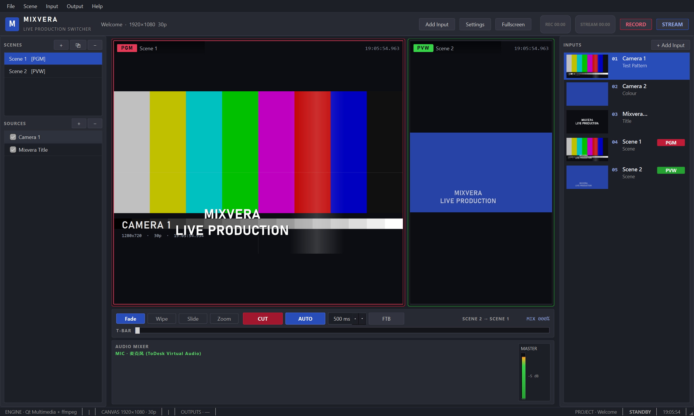

# Mixvera

Mixvera 是一个面向现场导播场景的开源切换台。`0.2.0` 是第一个真正可用的版本：能采集真实画面、编排场景、做 PGM/PVW 切换、录制并推流，界面在信息架构与视觉语言上同时参照 OBS Studio 与 vMix。



## 这一版能做什么

### 真实输入

| 输入 | 说明 |
| --- | --- |
| 屏幕采集 | 按显示器序号抓取整个桌面 |
| 窗口采集 | 枚举可见顶层窗口，优先抓窗口本体，失败回退到屏幕区域 |
| 摄像头 | 通过 Qt Multimedia 采集，系统里没有摄像头时列表为空 |
| 图片 / 视频文件 | 图片直接显示；视频循环播放，画面进入合成 |
| 标题 | 支持多行文本、字号、对齐、颜色 |
| 纯色 / 测试图案 | 用于垫场与信号检查，测试图案带活动扫描光带和时码 |

### 场景与图层

- OBS 式「场景 / 源」两栏：场景列表、当前场景的图层列表
- 图层支持显隐开关、上移 / 下移、从场景移除
- 场景可新增、复制、重命名、删除
- 工程以 JSON 保存，退出自动保存、启动自动恢复（`%APPDATA%/Mixvera/project.json`）

### 导播与转场

- 大 PGM + 小 PVW 双监视器，画面来自同一条渲染时间线
- `CUT` 硬切、`AUTO` 自动转场、`T-BAR` 手动推子（过半完成、不过半回退）
- 四种转场：`Fade` / `Wipe` / `Slide` / `Zoom`
- `FTB` 淡出到黑
- 转场时长 100–5000 ms 可调

### vMix 式输入列表

- 实时缩略图、输入编号、名称与类型
- `PGM` / `PVW` 状态标记、静音标记
- 双击设为预览；右键设为预览、切到节目、加入当前场景、属性、移除
- 「Add Input」对话框按类型给出对应参数（显示器、窗口、摄像头、文件、标题文本、颜色）

### 音频

- 每个带音频的输入一条通道：推子（-60…+12 dB）、静音
- 主输出电平表由系统默认录音设备实时驱动（不是动画）
- 没有输入设备时状态栏明确显示 `NO AUDIO INPUT`

### 输出

- `RECORD`：把合成后的 PGM 画面通过 ffmpeg 管道编码为 H.264 MP4
- `STREAM`：同一路画面推 RTMP（URL 与串流密钥在设置里配置）
- 顶栏 `REC` / `STREAM` 胶囊显示计时，状态栏显示 ON AIR / STANDBY
- 输出目录默认 `%USERPROFILE%/Videos/Mixvera`，可在设置里改成绝对路径

## 快捷键

| 按键 | 动作 |
| --- | --- |
| `Space` | CUT |
| `Enter` | AUTO |
| `F11` | 全屏 / 退出全屏 |
| `Esc` | 退出全屏 |
| `Ctrl+R` | 开始 / 停止录制 |
| `Ctrl+I` | 添加输入 |
| `Ctrl+S` / `Ctrl+O` | 保存 / 打开工程 |

## 界面来源

界面不是凭印象画的，颜色、控件命名与信息组织取自本机安装的 OBS Studio 33.0.3 与 vMix 28 的可读产物：

- **OBS**：`data/obs-studio/themes/Yami.obt` 的配色（`#1D1F26` / `#272A33` / `#13141A` / 蓝色 `#284CB8` / 红色 `#C01C37`）、停靠面板 + 场景/源 + 混音器的结构、`en-US.ini` 中的控件语义
- **vMix**：`languages/en.txt` 里 `frmmain.*` 的控件清单（Cut / Fade / Zoom / Wipe / Slide / FTB、Add Input、Overlay、Record、Stream、SRT、Audio Mixer、Settings 等）、输入对话框的输入类型分组，以及 PGM/PVW + 输入缩略图列表的布局

完整的对照与取舍见 [docs/UI-SPEC.md](docs/UI-SPEC.md)。没有复制任何 OBS 或 vMix 的代码与资源；只借鉴公开可观察的界面组织与配色值。

## 环境要求

- Windows 10/11 x64
- Qt 6.8.3 MinGW（Core / Gui / Widgets / Multimedia）
- MinGW 13.1、CMake ≥ 3.28、Ninja
- ffmpeg（录制与推流需要，需在 `PATH` 中）

## 构建与运行

```powershell
cmake --preset windows-mingw
cmake --build --preset windows-mingw
ctest --test-dir build/mingw --output-on-failure
```

直接运行（Qt 已在 PATH 时）：

```powershell
.\build\mingw\Mixvera.exe
```

打包成可脱离 Qt 环境运行：

```powershell
D:\Qt\6.8.3\mingw_64\bin\windeployqt.exe --release --no-translations --compiler-runtime build\mingw\Mixvera.exe
```

`windows-mingw` 预设里的 Qt、MinGW、Ninja 路径在 `CMakePresets.json`，可按本机安装位置修改。

## 工程文件

工程是纯 JSON（`core/project.cpp` 定义 schema）：画布尺寸与帧率、全部输入及其采集参数、场景图层几何、PGM/PVW、转场设置、输出配置。`File → Open Project…` 可打开任意工程，`--project` 参数可在启动时载入。

## 测试

四个测试目标，全部通过：

| 目标 | 覆盖 |
| --- | --- |
| `mixvera_core_tests` | 切换与 T-Bar 释放逻辑 |
| `mixvera_project_tests` | 工程 JSON 往返、默认工程合法性、图层几何 |
| `mixvera_ui_smoke_tests` | 真实界面：默认工程、CUT/AUTO/T-Bar、监视器出帧、场景选择不递归、界面录制落盘 |
| `mixvera_media_tests` | 屏幕采集出帧、窗口枚举、采集画面合成非黑、ffmpeg 录制文件可生成 |

## 当前边界

- 录制为**无声视频**：音频链路目前只做电平监测、增益与静音状态，尚未混入输出
- 未接入 SDI / DeckLink / NDI 采集；相应输入类型在领域模型里预留但未实现
- 场景图层目前按「整幅」放置，裁剪、缩放、拖拽定位的编辑器还没做
- RTMP 推流需要外部地址；推流与录制共用一条 ffmpeg 原始帧管道
- 依赖外部 `ffmpeg.exe`，仓库不内嵌二进制

## 目录

```text
apps/mixvera          应用入口
src/mixvera/core      领域模型、工程序列化、事件总线、服务容器
src/mixvera/services  输入、切换、转场、音频、输出、回放、设备
src/mixvera/engine    媒体引擎抽象（Stub，可选 libobs）
src/mixvera/ui        Qt 界面、媒体采集与合成、录制
tests                 core / project / ui / media 测试
```

详见 [docs/ARCHITECTURE.md](docs/ARCHITECTURE.md)。

## libobs 模式

准备好 libobs 的 CMake package 后：

```powershell
cmake -S . -B build-libobs -G Ninja -DCMAKE_PREFIX_PATH="D:/Qt/6.8.3/mingw_64;C:/path/to/obs/build" -DMIXVERA_ENABLE_LIBOBS=ON
cmake --build build-libobs
```

当前仅建立构建开关与引擎抽象，`LibobsMediaEngine` 适配层尚未实现。

## 许可

第三方依赖与许可说明见 [THIRD_PARTY_NOTICES.md](THIRD_PARTY_NOTICES.md)。若将来链接 libobs，分发需遵守 GPL-2.0-or-later。