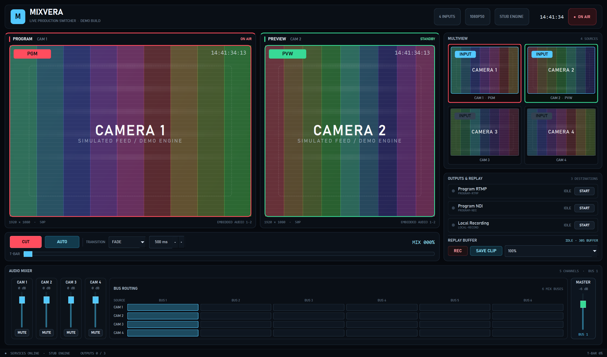

# Mixvera 0.1.0 Demo

第一版可运行的导播台 Demo。当前媒体引擎为 `StubMediaEngine`，PGM/PVW 与 MultiView 画面由程序生成，用于验证前端布局、服务层联动和切换工作流。



## 已实现

- PGM / PVW 双监视器，带模拟动态信号、安全框、时间码
- MultiView 四路信号，点击任意非 PGM 画面即设为 PVW
- CUT 硬切，AUTO 自动转场（默认 500 ms，可调 100–5000 ms）
- 手动 T-Bar，释放超过 50% 完成转场，低于 50% 回退
- 转场类型：FADE / WIPE / STINGER
- 四路音频推子、静音、Master 推子
- 4 × 6 总线音频路由矩阵
- 三路输出启停：Program RTMP、Program NDI、Local Recording
- Replay Buffer 录制开关、保存片段、100/50/25% 倍速
- 状态栏显示服务、输出数量和 T-Bar 位置
- 快捷键：`Space` CUT、`Enter` AUTO、`F11` 全屏、`Esc` 退出全屏

## 构建与运行

环境：Windows x64、Qt 6.8.3 MinGW、MinGW 13.1、CMake 4.x、Ninja。

```powershell
cmake --preset windows-mingw
cmake --build --preset windows-mingw
ctest --test-dir build/mingw --output-on-failure
.\build\mingw\Mixvera.exe
```

`windows-mingw` 预设默认使用：

- `D:/Qt/6.8.3/mingw_64`
- `D:/Qt/Tools/mingw1310_64`
- `C:/ST/STM32CubeCLT_1.22.0/Ninja/bin/ninja.exe`

若本机路径不同，请修改 `CMakePresets.json` 或改用显式 CMake 参数。

首次运行前如果缺少 Qt DLL，可执行：

```powershell
D:\Qt\6.8.3\mingw_64\bin\windeployqt.exe --release --no-translations --compiler-runtime build\mingw\Mixvera.exe
```

### 截图模式

```powershell
.\build\mingw\Mixvera.exe --screenshot docs\demo\mixvera-demo.png --screenshot-delay 1800
```

## 测试

- `mixvera_core_tests`：服务层切换与 T-Bar 释放逻辑
- `mixvera_ui_smoke_tests`：真实 Qt 界面中的 CUT、AUTO、T-Bar、输出启停、回放录制联动

```powershell
ctest --test-dir build/mingw --output-on-failure
```

## 当前边界

- 画面是模拟信号，尚未接入真实 SDI / NDI / 文件输入
- 输出按钮只切换服务状态，尚未创建 RTMP / NDI / 文件输出
- 音频推子与路由只更新服务状态，尚未驱动真实音频链路
- Replay 为交互骨架，尚未写入磁盘
- JSON-RPC 仅有请求处理骨架，尚未暴露网络端口
- 尚无项目保存/加载与设备枚举界面

这些能力会在 `LibobsMediaEngine` 和真实输出插件接入后逐步替换 Stub 实现，服务层接口保持不变。
