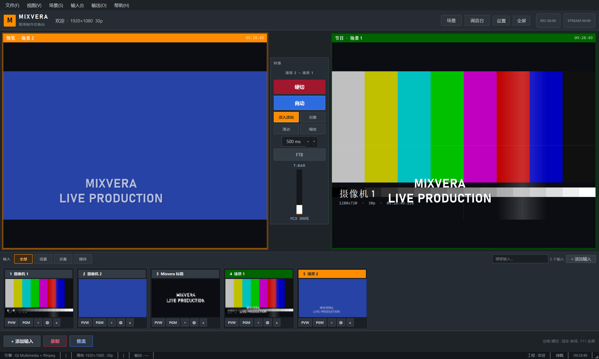
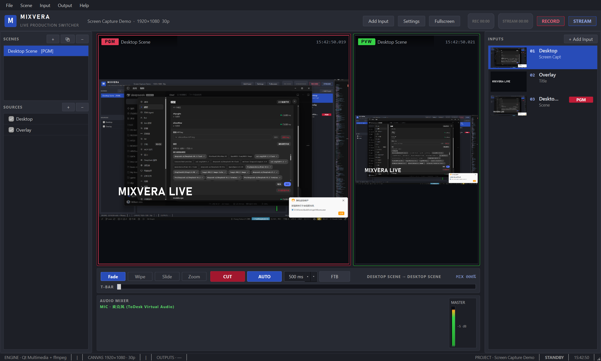

# Mixvera 0.3 使用说明

这一版已经可以当真正的导播台用：接真实画面、编场景、切换、录制。界面按 vMix 主窗口重排，并完整支持简体中文。



## 1. 第一次启动

启动后是一个「欢迎」工程，已包含：

- `摄像机 1`：活动测试图案（带扫描光带与时码）
- `摄像机 2`：纯色垫场
- `Mixvera 标题`：标题图层
- `场景 1`：测试图案 + 标题
- `场景 2`：纯色 + 半透明标题

PGM 显示场景 1，PVW 显示场景 2，可以直接按 `Space` 看一次硬切，或 `Enter` 看一次 500 ms 淡入淡出。

### 界面布局

- **左预览、右节目**：预览标题条为橙色，节目标题条为绿色
- **中央转场列**：硬切、自动、淡入淡出 / 划像 / 滑动 / 缩放、FTB、T-BAR
- **底部输入条**：缩略图、编号、名称、PGM/PVW 快捷按钮、分类筛选与搜索
- **底部功能栏**：`+ 添加输入`、`录制`、`推流`
- **顶栏**：`场景` / `调音台` 开关、`设置`、`全屏`、REC/STREAM 状态

### 界面语言

中文系统启动即显示简体中文。也可以在 `设置 → 界面语言` 里选择「简体中文 / English」，下次启动生效；或用命令行强制指定：

```powershell
.\Mixvera.exe --lang zh_CN
.\Mixvera.exe --lang en
```

## 2. 添加真实输入

点底部 **+ 添加输入**（或 `Ctrl+I`），选择类型：

| 类型 | 需要选择的参数 |
| --- | --- |
| 屏幕采集 | 显示器序号（对话框会列出分辨率） |
| 窗口采集 | 窗口标题（可刷新列表） |
| 摄像头 | 摄像头设备 |
| 图片 | 图片文件（png / jpg / bmp / webp / gif） |
| 媒体文件 | 视频或音频文件（循环播放） |
| 标题 | 文本、字号、对齐、颜色 |
| 纯色 | 颜色 |
| 测试图案 | SMPTE 彩条 |

新输入会自动加入当前场景，并出现在底部输入条里。

> 屏幕采集抓的是整个桌面。把 Mixvera 放在前面时会看到「画中画」递归效果，这是正常的。

## 3. 组织场景

点顶栏 **场景** 打开左侧面板：

- `+` 新建场景，`⧉` 复制，`−` 删除
- 单击 = 设为预览（PVW），双击 = 直接切到节目（PGM）
- 右键可重命名 / 复制 / 删除

**来源** 是当前场景的图层（从下到上）：

- 勾选框控制该图层显隐
- 右键可上移 / 下移 / 从场景移除
- `+` 从已有输入里挑一个加入当前场景

## 4. 切换与转场

- **硬切**（`Space`）：直接切
- **自动**（`Enter`）：按当前转场类型和时长自动完成
- **淡入淡出 / 划像 / 滑动 / 缩放**：四种转场
- **T-BAR**：手动推子，推过 50% 松手完成，不到 50% 自动回退
- **FTB**：淡出到黑

PGM 监视器在转场过程中会显示混合画面与 `MIX xx%` 读数。

## 5. 音频

点顶栏 **调音台** 打开右侧调音台：

- 带音频的输入（屏幕 / 窗口 / 摄像头 / 视频 / 音频文件）会出现通道
- 推子调节增益（-60…+12 dB），`M` 静音
- 主输出电平表由系统默认录音设备驱动；没有设备时显示「无音频输入」

## 6. 录制与推流

- **录制**：开始录制，顶栏 `REC` 胶囊开始计时，再点一次停止
- **推流**：按设置里的 RTMP 地址推流，顶栏 `STREAM` 胶囊计时

两者都通过 ffmpeg 的原始帧管道完成，需要 `ffmpeg` 在 `PATH` 中。路径与推流地址在 **设置** 里配置：

- 录制目录留空 → `%USERPROFILE%/Videos/Mixvera`
- 推流 URL 形如 `rtmp://live.example.com/app`，串流密钥单独填写，启动时会拼到末尾

录制文件名为 `Mixvera_yyyyMMdd_HHmmss.mp4`。



## 7. 工程与快捷键

工程自动保存在 `%APPDATA%/Mixvera/project.json`，退出自动写回，启动自动恢复。用 `文件 → 工程另存为…` 可另存，`文件 → 打开工程…` 可打开，也可以用命令行：

```powershell
.\Mixvera.exe --project D:\shows\demo.json
```

| 按键 | 动作 |
| --- | --- |
| `Space` | 硬切 |
| `Enter` | 自动转场 |
| `F11` / `Esc` | 全屏 / 退出全屏 |
| `Ctrl+R` | 录制启停 |
| `Ctrl+I` | 添加输入 |
| `Ctrl+S` / `Ctrl+O` | 保存 / 打开工程 |

## 8. 常见问题

**启动后黑屏 / 录像没有画面**
检查监视器是否显示「无信号」。摄像头与视频文件需要 Qt Multimedia 后端；若日志出现 `No QtMultimedia backends found`，说明 exe 同级缺少 `multimedia/` 插件目录，执行：

```powershell
D:\Qt\6.8.3\mingw_64\bin\windeployqt.exe --release --no-translations --compiler-runtime build\mingw\Mixvera.exe
```

**点录制报找不到 ffmpeg**
把 ffmpeg 加入 `PATH`，或在 `设置` 里确认提示行显示了 ffmpeg 路径。仓库不内嵌 ffmpeg。

**中文没有生效**
确认 `translations/mixvera_zh_CN.qm` 已编译并随 exe 打包；用 `--lang zh_CN` 可绕过 `QSettings` 强制中文。若仍显示英文，检查 `.ts` 的 context 是否带 `mixvera::ui::` 前缀。

**截图模式**

```powershell
.\Mixvera.exe --no-restore --lang zh_CN --screenshot out.png --screenshot-delay 2000
.\Mixvera.exe --no-restore --dump-ui ui-tree.txt
```

`--dump-ui` 输出控件树（类名、对象名、几何、文本），用于无视觉环境下的布局核对。
